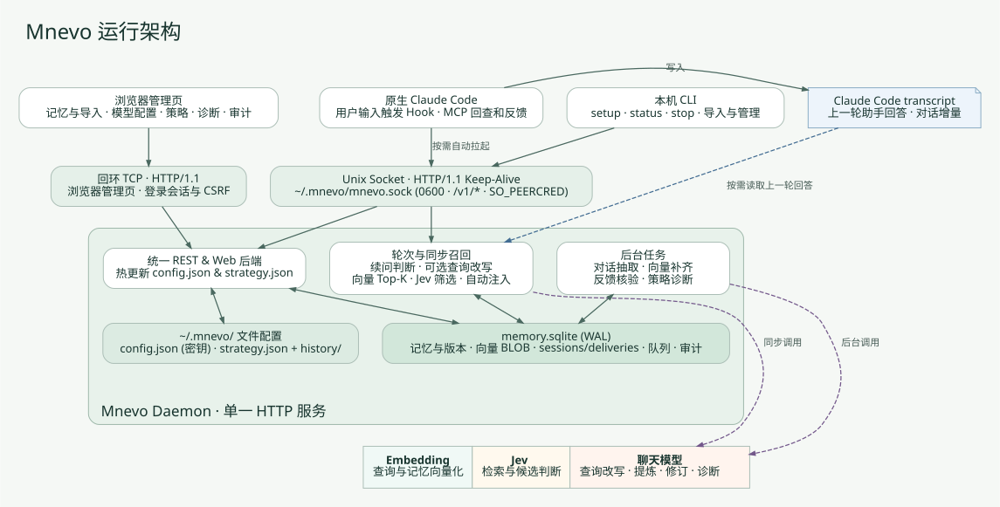
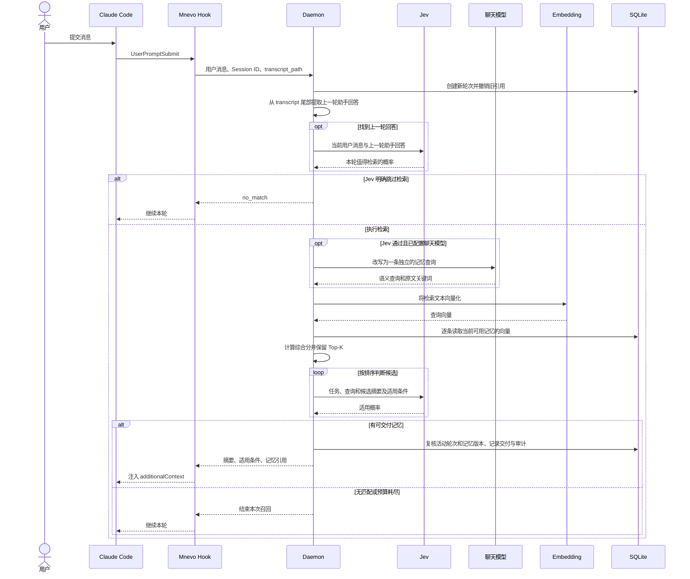

# Mnevo 当前架构与流程

Mnevo 是本机长期记忆服务。Claude Code 在用户提交消息时自动接收相关记忆。Daemon 处理会话轮次、召回、记忆写入和反馈，SQLite 保存持久状态，独立配置的模型端点提供概率判断、文本生成和向量化。

## 运行架构

| 组件 | 职责 |
| --- | --- |
| Claude Code Hook | 将用户输入、Session ID 和 `transcript_path` 传给 Daemon。收到记忆后，通过 `additionalContext` 注入摘要和引用。结束事件负责关闭轮次。 |
| MCP stdio | 使用 Go MCP SDK，提供 `get_memory` 回查和 `submit_memory_feedback` 反馈。两者都使用已交付的记忆引用。 |
| Daemon | 单一 Go HTTP 服务。Hook、MCP 和 CLI 走本机 Unix Socket，浏览器管理页走回环 TCP。同步召回与后台任务都在此运行。 |
| SQLite | 保存记忆、版本、来源、向量 BLOB、轮次、交付引用、后台队列和审计。 |
| 策略与模型注册表 | `strategy.json` 管理阈值、预算和可配置提示词，并归档策略版本。`config.json` 管理模型地址、名称和密钥。两者均支持热更新。 |

运行时接口和鉴权细节见 [协议规范](PROTOCOL.md)。架构图源文件为 [runtime-architecture.dot](runtime-architecture.dot)，运行 `make diagram` 可重新生成 SVG。

## 一个 Session 保存什么

SQLite 的 `sessions` 表保存 Session 的当前活动轮次和更新时间。每次 `UserPromptSubmit` 创建新轮次并撤销上一轮引用。`deliveries` 将交付绑定到 Session、轮次、记忆 ID 和版本，并记录有效期。

召回临时使用**当前用户消息和上一轮助手回答**。Daemon 从该 Session 的 Claude Code transcript 尾部最多读取 **512 KiB**，提取上一轮主对话的助手文本，最多 **1,500 字符**。工具调用、工具结果、子代理和内部记录会跳过。第一版的召回情境由这两段文本组成，按需从原记录读取。

`Stop`、`StopFailure` 和 `SessionEnd` 结束当前轮次并撤销引用。`Stop` 和 `SessionEnd` 还可按独立的 `transcript_cursors` 游标分批读取新内容。每批任务与游标一起提交，入队失败可从该批重试。

## 被动召回流程

以「预发部署缺少 `DATABASE_URL`」后的「生产也是这样吗？」为例，最新输入决定本轮关注**生产**。上一轮回答解释「这样」指的是数据库连接变量缺失。聊天模型生成类似「生产环境部署时 `DATABASE_URL` 的配置来源和缺失排查经验」的检索文本。Claude Code 仍收到用户原话，查询只进入 Mnevo 的召回链路。

| 阶段 | 当前行为 |
| --- | --- |
| 触发 | 仅普通 `UserPromptSubmit` 进入召回。以「记住：」开头的输入走记忆写入。 |
| 准备查询 | 首轮或读不到上轮回答时使用用户原话。有上轮回答时，Jev 用两段文本决定是否检索，例如确认语可以跳过。通过时，已配置的聊天模型生成一条查询，并可提供最多四个能在原文验证的关键词。前置 Jev 失败，或聊天模型缺失、超时、改写无效时，用当前问题与上轮回答拼接查询。 |
| 候选检索 | Embedding 将最终查询转为向量。SQLite 筛出已确认、已启用、未过期且当前版本有同模型向量的记忆。Go 流式计算余弦相似度和综合分 `相似度 × 强度 × 2^(-年龄 / 半衰期)`，只保留 Top-K。关键词随文本一起向量化，当前使用语义检索。 |
| 候选判断与注入 | Jev 按综合分顺序逐条判断是否适用。通过后，Daemon 复核活动轮次和记忆版本，在预算内写入交付记录并注入摘要、适用条件和引用。Agent 可以按引用回查详情和来源。 |

默认策略使用 **0.45** 的余弦相似度下限、**0.25** 的综合分下限，最多将 **6 条**送给候选 Jev，最多交付 **3 条**。两个召回 Jev 阶段都使用 `recall.jev_threshold`，默认分数须**大于 0.25**。引用默认最长 **30 分钟**，轮次结束时即可提前失效。

Hook 的 IPC 预算是 **600 ms**，Daemon 的召回策略默认是 **500 ms**，服务端额外以 **550 ms** 封顶。续问的前置 Jev 和可选查询改写共用 **150 ms**，Embedding 默认最多 **180 ms**，候选 Jev 默认共用 **220 ms**，各阶段均受剩余总时间约束。召回依赖 Embedding 和 Jev，可选聊天模型负责写查询。配置远端模型时，对应该阶段的查询、上下文或候选摘要会发往配置的端点。

## 形成、反馈与策略学习

| 流程 | 当前行为 |
| --- | --- |
| 显式记住 | 「记住：」返回入队回执。自然语言由聊天模型提炼，结构化草稿经校验后入库。 |
| 对话形成 | 轮次结束后增量读取 transcript 并入队。后台 Jev 判断是否有长期价值，聊天模型提炼通过的片段。 |
| 文档导入 | CLI 或 Web 提交文档后分段，依次由 Jev 筛选和聊天模型提炼，形成带来源的版本。后台补齐缺失的当前模型向量。 |
| 反馈与修订 | Agent 用活动引用提交幂等反馈。后台对纠正或过时反馈先调用 Jev，再由聊天模型核验。确认修订后发布新版本并补齐向量。 |
| 策略学习 | 收集审核过的诊断证据。样本达到阈值后，后台 Jev 判断是否属于系统性问题，聊天模型提出参数或提示词调整。Daemon 校验可学习范围和参数边界，按策略审批或在预授权的边界内应用。 |

主要实现见 [召回编排](../internal/recall)、[会话与持久化](../internal/store)、[模型适配](../internal/model) 和 [Claude Code 集成验证](INTEGRATION.md)。
