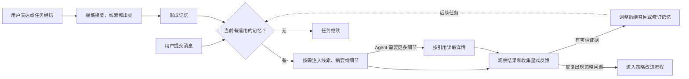
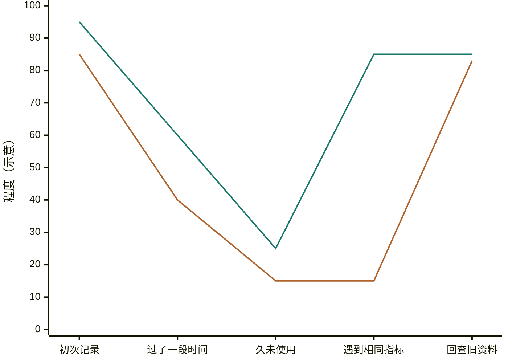
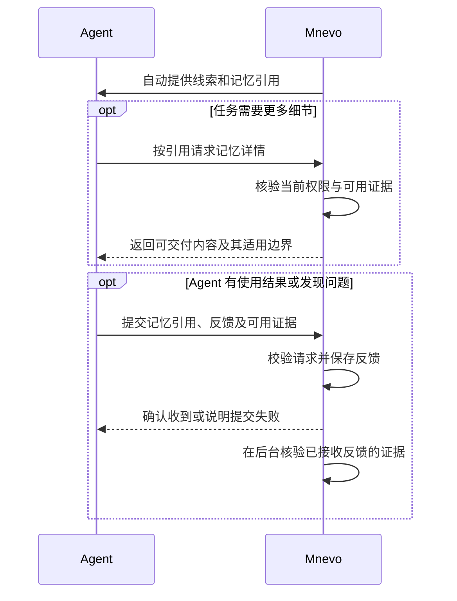
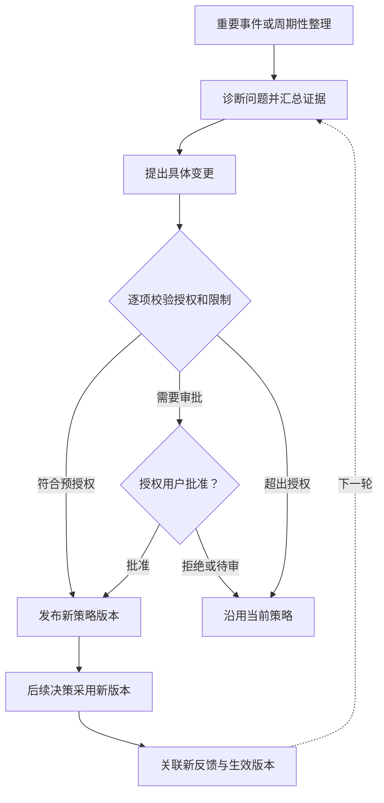

# Mnevo · 忆循

**产品需求文档 · v0.1**

**面向 AI Agent 的自适应长期记忆引擎**

让 Agent 在需要时想起，也能循着线索找回细节。

## 1. 产品定位

长期使用 Agent 时，有价值的信息散落在不同对话、任务和资料中。用户可能已经澄清过报告口径、确认过一项写作偏好，或解释过某次决定的原因。后续任务既需要延续这些信息，也需要知道它们适用于哪些情境、能与谁共享。

Mnevo 为个人、团队和 Agent 应用提供跨任务、跨会话的长期记忆能力。Mnevo 从用户表达、任务经过和可验证结果中形成可追溯的记忆，并在新的任务中自动提供适用的信息。Agent 可以按引用读取记忆详情，并提交使用反馈。Mnevo 根据可信反馈更新记忆或调整后续提供方式。反复出现的系统性问题进入策略评估与审批流程。

本文所称 **Agent** 是执行任务的智能体。**Agent 应用**是用户用来启动和管理 Agent 会话的软件，例如 Claude Code。**注入**指 Mnevo 通过 Agent 应用将记忆添加到当前任务的上下文。**记忆引用**是 Mnevo 随记忆提供的短期凭证，用于请求详情或提交反馈。

### 目标用户与场景

| 用户 | 需求 | 典型场景 |
| --- | --- | --- |
| Agent 应用开发者 | 接入通用的长期记忆能力，并能追溯记忆形成、注入和修订的依据 | 为不同 Agent 应用提供统一的记忆能力，支持跨会话延续任务 |
| 持续使用 Agent 的个人 | 跨会话延续个人偏好、约定和既往决定 | 续写长文、组织资料、记住已明确的表达偏好 |
| 使用 Agent 协作的团队 | 在授权范围内复用已核验的知识与工作经验 | 沿用报告口径、追溯决策依据、复用经过验证的流程 |

首版在研究与报告写作、个人偏好和开发排障场景中验证同一套记忆能力。工作范围可以是个人、某项任务、研究主题、组织工作区或代码项目。这些场景共用同一套记忆、证据和反馈规则。

### 首版交付边界

v0.1 交付记忆形成、情境唤起、记忆演化和元认知自我修正四项能力。Claude Code 是首个接入的 Agent 应用，用于验证开发与非开发任务。本机单用户服务的各会话共用一个记忆库，Agent 退出后，服务继续处理已接收的后台任务。本地管理页面和命令行界面提供记忆管理与策略审批功能。

首版的 Agent 读取入口只接受有效的交付引用。细粒度会话与来源授权、Agent 自由搜索记忆库、Codex 适配、远程多租户服务、复杂多跳知识网络和模型训练留待后续版本。

## 2. 统一记忆模型

| 主类型 | 保存的信息 | 示例 |
| --- | --- | --- |
| 事实（Fact） | 有出处的状态、属性、关系或约束 | 这份报告的留存指标按注册用户计算 |
| 经历（Episode） | 曾发生的事件、当时条件及结果 | 两期报告曾因统计口径不同而无法直接比较 |
| 方法（Procedure） | 在特定条件下可参考的操作步骤 | 从资料中提取指标定义，按来源和日期编制对照表 |
| 偏好（Preference） | 特定主体在特定情境下的倾向 | 用户希望报告先给主要结论 |
| 准则（Guideline） | 有来源和适用范围的行为指导 | 合并数据前核实统计口径 |

每条记忆有一个主类型，可以包含标签和关联。可分别验证或修订的内容应拆为独立记忆，并通过共同来源关联。记忆类型描述内容性质。记忆在当前任务中的用途随情境确定。例如，一条经历可以作为排查线索，一条准则可以作为检查提醒。Agent 应遵循当前有效指令及已授予的权限。

| 组成 | 产品要求 |
| --- | --- |
| 摘要 | 保存简短、可独立理解的内容，供日常召回 |
| 唤起线索 | 保留有辨识度的情境特征，如主题、实体、任务目标、资料标识或错误签名 |
| 细节与证据 | 对具体主张保留出处，可回查获准访问的日志、文件、工具结果或用户确认 |
| 归属与访问范围 | 首版以本机系统用户为边界。后续可记录归属主体、共享范围和来源约束 |
| 适用边界 | 记录使用条件、有效期和最近核验的情境 |
| 可信状态与版本 | 区分已确认、待核验、争议、已替代和已失效等状态，保留关键修订依据 |
| 使用与反馈记录 | 保留最近一次有依据的强化时间，以及有限的情境反馈摘要和重要例外 |

## 3. 核心体验

**图 1 · 记忆生命周期**

### 3.1 记忆形成

优先从用户确认与纠正、经验证的方法、重要前置条件及反复出现的失败中形成记忆。记忆应包含摘要、唤起线索、来源、适用范围和可信状态。模型推测可记录为待核验线索，须经独立证据验证后才能确认为事实。重复信息应合并。保存敏感信息须取得相应授权。

### 3.2 自动唤起、遗忘与清晰度

用户提交消息时，Mnevo 判断是否应向当前任务提供记忆。续问可结合上一轮助手回答补充情境。无适用记忆或召回超时时，Agent 应用继续执行任务，Mnevo 记录处理结果。

每次唤起分别判断三个问题。

| 维度 | 产品行为 |
| --- | --- |
| **唤起强度** | 长期缺少有效强化时，普通召回中的优先级可以随时间降低。高度匹配的情境线索可重新唤起仍有权访问的旧记忆。可信反馈可以强化记忆。交付记忆、重复检索和模型预测只作记录。衰减规则可以按记忆类型和有效性要求区分。 |
| **回忆清晰度** | 根据任务需要和可用证据，提供线索、摘要或有出处的细节。高度匹配的情境线索出现且任务需要细节时，可在规定时间内查阅证据。出处不可访问、证据冲突或查阅超时时，仅提供证据支持的内容，必要时省略该条记忆。 |
| **当前适用性** | 在本机用户的可用记忆中检查任务范围、时效、前置条件和冲突。清楚的历史记录可以作为参考，能否用于当前行动取决于当前条件。仍然有效的明确约束持续参与判断。 |

遗忘影响常规召回的优先级。内容的失效、停用、删除及证据留存按各自规则处理。回忆清晰度在每次召回时根据任务情境和可用证据确定。同一条记忆在一次召回中可只提供摘要，在需要细节且证据可用时可提供详细内容。

**示例。** 上季度汇报时，两份资料对「活跃用户」的定义不同，团队因此调整了对比方式。经过一段时间，这条经历在日常任务中逐渐淡出。下一次 Agent 编写同主题报告时，Mnevo 可以提示「这两份资料的活跃用户口径曾经不同」。如果获准回查旧资料，Agent 可以读取两种定义及其来源，再核对本期口径是否有变。

**图 2 · 记忆淡出、重新唤起与细节恢复**

绿线表示唤起强度，棕线表示可提供的细节程度。再次遇到相同指标时，记忆先浮现。回查旧资料后，才补全细节。横轴为事件顺序，纵轴数值仅用于示意。

### 3.3 按引用读取、反馈与记忆演化

**按引用读取。** 注入的记忆内容均附带记忆引用。Agent 可以用该引用请求当次交付版本的完整内容。Mnevo 根据当前权限与留存状态，返回该条记忆的摘要、明细、适用范围和可读的证据摘录。

读取时校验短期引用及其记忆版本。引用过期或撤销，或记忆停用、删除、过期或因纠正被替代时，返回不可用。短期引用的使用边界见下文。

**显式反馈。** Agent 在收到或按引用读取记忆后，可用同一引用提交「有帮助」「不适用」「疑似过时」或「建议纠正」。提交应说明原因，有可验证结果时可附上证据引用。Mnevo 记录反馈对应的记忆版本、交付情境和来源。同一提交的重试只处理一次。用户可在对话中或通过本地管理入口纠正记忆。

每次关键唤起决定应记录记忆版本、策略版本、触发情境和实际交付内容。Mnevo 根据执行事件观察结果，并区分读取记录、Agent 自报结果、可验证结果和用户明确纠正。未经核验的反馈可作为使用记录或修订线索。单次读取、正面评价或任务成功，均不足以确认某条记忆准确或对结果有实际贡献。

可信反馈可以调整下一次类似情境的唤起强度、适用范围或表述。修改记忆内容需要可信的新证据，并保留原有记录和变更依据。普通重复反馈按记忆和有限的情境类别聚合，明确纠正、重要冲突及授权记录保留可追溯依据。

**图 3 · Agent 按引用读取记忆并提交反馈**

### 3.4 元认知与策略改进

Mnevo 应识别反复出现的记忆遗漏、召回遗漏、不适当的注入、错误的反馈归因和不当修订，并判断问题源于记忆内容、Mnevo 策略还是 Agent 的任务执行。证据充分时，Mnevo 可提出参数、策略或提示词的具体变更，列明证据、变更前后的内容、影响范围和风险。同类问题应合并证据并统一审查。

参数和提示词逐项授权。人工设置学习许可、允许范围和生效方式。已预授权的低影响调整可在限定范围内生效，高影响或标为需审批的变更必须由授权用户批准。模型可以提议修改获准学习的值。学习许可、审批方式、权限边界由授权用户控制。元学习自身的参数和提示词同样遵守逐项授权，每轮使用固定策略版本。

重要事件和周期性整理均可触发后台元学习。审批后的变更应实际进入运行时，并记录旧值、新值、证据、审批者、生效版本和时间。后续反馈关联生效版本，供下一轮诊断。发现副作用时提示复核，授权用户可以把恢复历史值作为一次新变更提交。

**图 4 · 策略变更如何生效**

## 4. v0.1 功能需求

下表各项均为首版必需。

| ID | 需求 | 可观察的通过条件 |
| --- | --- | --- |
| MEM-01 | 从经历形成记忆 | 从用户确认或可验证结果形成有出处的简短记忆。重复事件可合并 |
| MEM-02 | 统一管理五类记忆 | 五类记忆可查看、检索及修订，可辨识其主类型、来源和适用范围 |
| MEM-03 | 自动选择性唤起 | 用户提交消息时触发。续问可以结合上一轮回答决定是否检索 |
| MEM-04 | 分类注入 | 注入内容标明其在当前任务中的用途和关键适用条件。经历可作为历史参考，方法可作为操作提示，准则可作为检查提醒 |
| MEM-05 | 观察使用并接收明确反馈 | 能区分正向证据、冲突与证据不足。任务成功或未观察到使用不直接改变事实可信状态 |
| MEM-06 | 反馈影响下一次唤起 | 可信纠正可改变下一次选择或表述。重复反馈聚合 |
| MEM-07 | 受控修订和合并 | 能补充、失效、合并和标记争议。实质性修订可追溯 |
| MEM-08 | 用户管理 | 用户可查看、纠正、停用和删除记忆。停用和删除的记忆应退出候选 |
| MEM-09 | 随时间衰减并允许线索唤起 | 其他条件相同时，久未强化的记忆在常规召回中的优先级下降。高度匹配的线索可以重新唤起这条记忆 |
| MEM-10 | 分级回忆与证据补全 | 能按需提供摘要或细节，并返回记忆版本所保存的来源信息 |
| MEM-11 | 按引用读取完整记忆 | 有效的交付引用可读取当前版本的详情。引用失效或被撤销后返回不可用 |
| MEM-12 | Agent 提交显式反馈 | 针对已交付记忆可提交帮助、不适用、过时或纠正反馈。反馈可关联版本和证据，重试只处理一次，未经独立证据的自述保留原证据等级 |
| META-01 | 关键决策可追溯 | 能还原一次误召回或错误修订所用的情境、依据和策略版本 |
| META-02 | 识别系统性问题 | 多次同类误判可汇聚出诊断线索。证据不足时保留不确定性 |
| META-03 | 生成可审阅的提案 | 授权用户可通过本地管理页面和命令行界面查看提案的证据、变更内容、影响范围和风险，并可批准或拒绝 |
| META-04 | 授权后实际生效 | 未获必要授权的修改不影响运行。经授权发布的新版本能改变后续行为 |
| META-05 | 保留改进历史并继续学习 | 后续反馈可关联到生效版本。恢复旧值产生一条新的授权变更记录 |

## 5. 可信边界与运行要求

### 5.1 访问权限与适用范围

| 检查 | 产品规则 |
| --- | --- |
| 谁能访问记忆 | 首版以本机系统用户为信任边界。同 UID 的本机 IPC 调用方持有有效引用时，可读取详情或提交反馈。 |
| 引用何时失效 | 引用记录绑定交付轮次和版本，用于撤销与追踪。轮次结束、新轮开始、记忆停用或版本变化可使旧引用提前失效。 |
| 能否回查来源 | 引用读取返回当前版本保存的来源位置和摘录。原始文件由运行环境的文件权限保护。 |
| 记忆是否适用 | 根据当前任务、目的、时效和前置条件判断。用户本轮的有效要求优先于历史偏好。 |

跨用户、按会话限制持有者身份、以及逐来源授权属于后续产品范围。首版的技术细节见 [Claude Code 集成与验证](INTEGRATION.md)。

### 5.2 运行要求

- **用户控制。** 记忆管理和策略审批须通过本机授权。本地管理页面和命令行界面采用相同的授权和审计规则。记忆停用或删除后，应停止通过索引、缓存或已排队的任务向 Agent 提供该记忆。
- **故障处理。** 区分无适用记忆、证据不可用和系统故障。检索、证据查阅或判断超时后，Agent 应用应能继续执行任务，Mnevo 应记录实际处理结果。
- **后台连续性。** 后台学习与实时唤起独立。Agent 退出后已入队任务继续处理，服务重启后可恢复。重复投递或重试不得造成重复强化或重复发布策略。
- **成本与留存。** 限制注入长度、回查预算及反馈保留规模。普通反馈采用有限聚合，重要证据和策略历史按留存规则保存。

## 6. 端到端验收

在 Claude Code 中进行研究报告、个人偏好和开发排障的真实任务验收。通过控制时钟、任务情境和策略版本的回放复核衰减与历史行为。

| 场景 | 通过条件 |
| --- | --- |
| 首次学习与跨会话复用 | 一次验证成功的方法形成有出处的记忆，下一次任务可自动收到带前置条件的提示 |
| 遗忘与找回细节 | 经可控时间推进，旧经历在普通召回中排序下降。编写后续报告时遇到相同指标可唤起旧经历，回查原资料后补充口径差异 |
| Agent 按引用读取完整记忆 | 自动注入提供报告口径摘要和引用。Agent 用有效引用获得保存的指标定义、适用日期和来源摘录。轮次结束或停用记忆后，旧引用返回不可用 |
| Agent 主动反馈记忆有误 | Agent 提交环境不匹配的反馈和工具结果。重复提交只记一次。核验后，后续相似情境的注入发生可观察的变化。不带证据的反馈留作线索 |
| 历史证据与环境变化 | 保存的来源信息可供回查。经历类记忆标明需要重新核验，帮助 Agent 识别环境变化 |
| 明确纠正与适用范围 | 用户纠正某类报告的表达偏好后，同类报告反映修正，个人笔记等其他任务依据各自适用条件筛选 |
| 续问自动注入 | 用户提交简短续问时，可以利用上一轮助手回答补足检索线索。工具执行期间沿用本轮已交付的上下文 |
| 反馈有效且增长可控 | 多次同类反馈在有限情境内聚合，下一轮可观察到选择变化。一次无证据的模型判断不强化记忆 |
| 受控策略修正 | 重复跨项目误注入触发可审阅提案。批准前沿用当前版本，批准并发布后按新策略运行。后续反馈进入该版本的改进历史 |
| 后台恢复与故障处理 | Agent 退出后，Mnevo 继续处理事件和定期整理任务。服务重启后恢复未完成任务。Mnevo 区分召回超时和无匹配结果，Agent 应用继续执行任务 |

## 7. 待定项

| 议题 | 需要确定的内容 |
| --- | --- |
| 衰减与强化 | 各类型的初始半衰期、不同证据的强化强度、应持续参与适用性判断的记忆 |
| 回忆清晰度与证据留存 | 何时查阅细节，日志和证据的保留期限，来源失效后的呈现方式 |
| 引用与反馈接口 | 引用有效期、Agent 调用方式、响应大小上限，以及哪些反馈需要通知用户 |
| 记忆修订与共享 | 哪些修订可自动生效，哪些需要用户确认，以及共享范围如何由授权主体配置 |
| 注入时限与容量 | Agent 应用等待 Mnevo 响应的时限、允许延迟交付的条件、超时处理方式和注入长度上限 |
| 治理与元学习 | 本机审批身份校验、系统性问题的证据门槛、默认历史窗口、复核条件和成本预算 |
