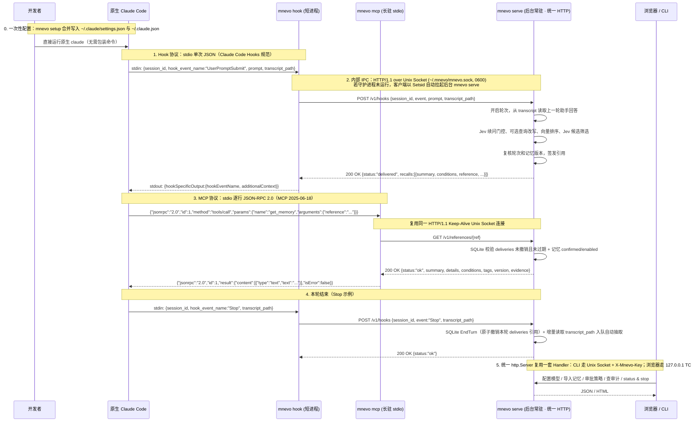

# Mnevo 进程间交互与外部协议规范

本文档完整描述 Mnevo 系统中各进程之间的通信信道、统一 HTTP Handler 路由、鉴权边界、超时与容错约定，以及服务侧外部模型 HTTP 契约。

---

## 1. 进程拓扑与交互时序

Mnevo 以单二进制形态运行，采用 **一次配置（`mnevo setup`）+ 原生运行 `claude` + 按需自动拉起后台常驻服务** 的零侵入接入模式。运行期仅涉及 **3 类进程**（原生 Claude Code 拉起的 `mnevo hook` 短进程、`mnevo mcp` 长驻 stdio 进程、后台常驻 `mnevo serve` 守护进程）以及 CLI / 浏览器管理端：



时序图展示成功注入时的进程间消息。首轮、跳过检索、模型回退与预算见 [被动召回流程](CURRENT_STATE.md#被动召回流程)。

---

## 2. 统一 HTTP Server 与传输隔离设计

实现位置：[internal/daemon/server.go](../internal/daemon/server.go)、[internal/daemon/handlers.go](../internal/daemon/handlers.go)、[internal/daemon/client.go](../internal/daemon/client.go)

Mnevo 守护进程仅运行 **单个 `net/http.Server`**，同时挂载两个监听器并按 `ConnContext` 严格隔离路由：

1. **Unix Domain Socket（`~/.mnevo/mnevo.sock`，权限 `0600`）**：
   - `ConnContext` 通过 `verifyUnixPeer` 校验连接来自 Unix Socket（Linux 下进一步通过内核 `SO_PEERCRED` 核验 `Uid == os.Geteuid()`），标记为 `transportUnix`；
   - 仅路由到标准库 `http.ServeMux`（Go 1.22+ 方法+路径模式）挂载的 **`/v1/*` REST API**；
   - 可直接使用 `curl --unix-socket ~/.mnevo/mnevo.sock http://mnevo/v1/health` 调试。
2. **本机回环 TCP（可选 `127.0.0.1:8765`，`-web-fallback` 支持端口占用时自动回退至随机空闲端口）**：
   - `ConnContext` 标记为 `transportTCP`；
   - 仅路由到浏览器管理页 `web.Handler`（`/`）；任何经 TCP 访问 `/v1/*` 的请求直接返回 **`404 Not Found`**，确保外部或浏览器无法触达 Agent/Admin REST API。

| 通信双方 | 传输通道 | 协议格式 | 鉴权方式 | 单消息上限 | 超时与容错 |
| --- | --- | --- | --- | --- | --- |
| **Claude Code ↔ `mnevo hook`** | `stdin` / `stdout` | 单次 JSON 对象 | 由 Claude Code 按 `settings.json` 直接拉起 | `128 KiB`（stdin） | 单次召回预算 `600ms`；冷启动自动拉起后台服务（最长 `2.5s`）；任何错误静默退出 `0`、stdout 为空（Fail-Open） |
| **Claude Code ↔ `mnevo mcp`** | `stdin` / `stdout` | 逐行 **JSON-RPC 2.0** | 由 Claude Code 按 `.claude.json` 直接拉起 | `256 KiB` / 行 | 单次 RPC `3s`（复用 Unix Socket Keep-Alive）；服务不可用时返回 `{"status":"unavailable"}`（`isError: true`） |
| **Hook / MCP / CLI ↔ `mnevo serve`** | Unix Domain Socket (`~/.mnevo/mnevo.sock`) | **HTTP/1.1 + JSON**（支持 Keep-Alive，`DisallowUnknownFields`） | 目录 `0700` + 套接字 `0600` + 内核 `SO_PEERCRED` 同 UID；管理接口校验 `X-Mnevo-Key`（常量时间比较）；Hook/MCP 客户端最小权限不发送 `admin.key` | `256 KiB` | `hook`: `600ms`；常规 IPC: `3s`；`import` / `model test`: `60s`；默认按需自动拉起（`MNEVO_NO_AUTOSTART=1` 可关闭） |
| **浏览器 ↔ `mnevo serve`** | `127.0.0.1:PORT` TCP | HTTP/1.1（Templ SSR + htmx 局部刷新 + 表单/JSON） | 会话 Cookie 登录（`mnevo` + `admin.key` → `HttpOnly`/`SameSite=Strict` 随机会话，12h TTL）+ 回环/`web.public_url` `Host` 与 `Origin` 白名单 + 会话绑定随机 CSRF + 严格 CSP | `256 KiB`（POST） | `ReadHeader`: `2s`；`Read`: `10s`；`Write`: `65s`；`Idle`: `60s` |

---

## 3. 各协议详细规范

### 3.1 `mnevo setup` / `mnevo uninstall` 与原生 Claude Code 集成

实现位置：[internal/agent/claude/setup.go](../internal/agent/claude/setup.go)

- **配置路径解析**：
  - 默认：Hooks 写入 `~/.claude/settings.json`，stdio MCP 写入 `~/.claude.json`；
  - 当设置 `-claude-dir <DIR>` 或环境变量 `CLAUDE_CONFIG_DIR` 时，两者均写入 `<DIR>/settings.json` 与 `<DIR>/.claude.json`。
- **幂等合并与原子写**：
  - 保留用户已有的其他设置、其他 Hook 与其他 `mcpServers`；重复执行 `mnevo setup` 会自动更新二进制路径而不会产生重复条目；
  - 写入使用同目录临时文件 `0600` + `os.Rename` 原子替换；
  - `setup` 和 `uninstall` 都会清理旧版注册的 Mnevo `PostToolBatch`。卸载同时移除现行 Hook 和 `mcpServers.mnevo`。

### 3.2 Claude Code ↔ `mnevo hook`（stdio）

实现位置：[internal/agent/claude/hook.go](../internal/agent/claude/hook.go)

- **注册事件**：`UserPromptSubmit`、`Stop`、`StopFailure`、`SessionEnd`。
- **输入（stdin JSON）**：
  ```json
  {
    "session_id": "550e8400-e29b-41d4-a716-446655440000",
    "hook_event_name": "UserPromptSubmit",
    "prompt": "用 Go 实现支付退款接口",
    "transcript_path": "/path/to/session.jsonl"
  }
  ```
- **事件处理规则**：
  - `Stop` / `StopFailure` / `SessionEnd`：触发 SQLite `EndTurn` 立即撤销本会话当前轮的 `deliveries` 引用；对 `Stop` / `SessionEnd` 透传 `transcript_path`，由守护进程按 `transcript_cursors` 偏移增量入队异步抽取记忆。
  - `UserPromptSubmit` 开启新轮次。以「记住：」开头时异步入队并返回回执。普通输入进入召回，Daemon 从 transcript 尾部读取上一轮助手回答。找到回答时，Jev 判断是否检索，已配置的 LLM 可进一步生成语义查询。首轮或缺少回答时直接用用户输入检索。
- **输出（stdout JSON）**：仅当 `status` 为 `delivered` / `accepted` / `invalid` 时输出；其余状态（`no_match`、`filtered`、`timeout`、`unavailable`）不输出任何内容。
  ```json
  {
    "hookSpecificOutput": {
      "hookEventName": "UserPromptSubmit",
      "additionalContext": "Mnevo 检查提醒（summary）\nGo 接口方法首参统一使用 context.Context\n适用条件 Go 后端代码开发\n记忆引用 <64-hex>\n可通过 mnevo 的 get_memory 回查细节，发现变化可通过 submit_memory_feedback 提交反馈。"
    }
  }
  ```

### 3.3 Claude Code ↔ `mnevo mcp`（JSON-RPC 2.0 over stdio）

实现位置：[internal/agent/claude/mcp.go](../internal/agent/claude/mcp.go)

- **支持协议版本**：`2024-11-05`、`2025-03-26`、`2025-06-18`（默认协商为 `2025-06-18`）。
- **服务标识**使用 `mnevo`，`serverInfo.version` 与 `mnevo version` 报告相同的构建版本。
- **协议处理**由官方 Go MCP SDK 负责，包括初始化、`notifications/initialized`、`ping`、`tools/list` 和 `tools/call`。未知工具或无效工具参数返回 `-32602`。
- **两个 MCP 工具**均使用 Hook 已交付的记忆引用，参数按 `additionalProperties: false` 严格解码。

| 工具名 | 必填参数 | 可选参数 | 对应内部 REST 路由 |
| --- | --- | --- | --- |
| `get_memory` | `reference`（64 位十六进制引用） | — | `GET /v1/references/{ref}` |
| `submit_memory_feedback` | `reference`、`kind`（`helpful` / `not_applicable` / `outdated` / `correction`）、`reason`、`idempotency_key` | `evidence` | `POST /v1/references/{ref}/feedback` |

### 3.4 内部 Unix Socket HTTP REST API（`~/.mnevo/mnevo.sock`）

实现位置：[internal/daemon/handlers.go](../internal/daemon/handlers.go)

| 方法与路径 | 鉴权 | 用途说明 | 客户端超时 |
| --- | --- | --- | --- |
| `GET /v1/health` | 同 UID Unix Socket | 查询运行态、`pid`、`web_url`、模型就绪态与向量化进度（`mnevo status`） | `3s` |
| `POST /v1/shutdown` | `X-Mnevo-Key` | 优雅关闭守护进程并清理套接字（`mnevo stop`） | `3s` |
| `POST /v1/hooks` | 同 UID Unix Socket | 处理 `UserPromptSubmit` / `Stop` / `StopFailure` / `SessionEnd` | `600ms`（服务端受 `recall.deadline_ms` 约束） |
| `GET /v1/references/{ref}` | 同 UID Unix Socket | 校验 SQLite `deliveries`（`revoked=0 AND expires>now`）并返回记忆详情与出处 | `3s` |
| `POST /v1/references/{ref}/feedback` | 同 UID Unix Socket | 幂等提交反馈并返回回执（同键异内容返回 `conflict`） | `3s` |
| `POST /v1/memories/propose` | 同 UID Unix Socket | Agent 异步提议长期记忆并返回回执 | `3s` |
| `POST /v1/observations/miss` | 同 UID Unix Socket | Agent 上报疑似漏召回线索 | `3s` |
| `GET /v1/memories` · `POST /v1/memories` · `POST /v1/memories/import` | `X-Mnevo-Key` | 检索记忆、新增记忆、Jev+LLM 智能导入文档 | `3s`（`import` 为 `60s`） |
| `GET /v1/memories/{id}` · `PUT /v1/memories/{id}` · `DELETE /v1/memories/{id}` · `POST /v1/memories/{id}/{action}` | `X-Mnevo-Key` | 查看、人工修订、删除、启用/停用/争议/失效 | `3s` |
| `GET /v1/models` · `PUT /v1/models/{role}` · `POST /v1/models/{role}/test` | `X-Mnevo-Key` | 查看脱敏配置、热更新 `config.json`、测试 `embedding`/`jev`/`llm` 连通性 | `3s`（`test` 为 `60s`） |
| `GET /v1/strategy` · `GET /v1/strategy/history` · `PUT /v1/strategy/settings/{key}` · `PUT /v1/strategy/prompts/{key}` · `POST /v1/strategy/rollback` | `X-Mnevo-Key` | 读取策略与历史、更新参数/Prompt、一键回滚 | `3s` |
| `GET /v1/proposals` · `POST /v1/proposals/{id}/{approve\|reject}` | `X-Mnevo-Key` | 查看与审批元学习提案 | `3s` |
| `GET /v1/observations` · `POST /v1/observations` · `POST /v1/observations/{id}/confirm` | `X-Mnevo-Key` | 查看、录入与确认诊断证据 | `3s` |
| `GET /v1/audit?before={id}` | `X-Mnevo-Key` | 游标分页查询审计日志（单页最多 250 条且受 `256 KiB` 裁剪） | `3s` |

### 3.5 本地管理页 HTTP 协议（`127.0.0.1:PORT`）

实现位置：[internal/web/server.go](../internal/web/server.go)

- **绑定限制**：严格校验监听主机为 `127.0.0.1`，拒绝绑定 `0.0.0.0` 或非回环地址。
- **安全头与防御**：
  - `Cache-Control: no-store`、`X-Content-Type-Options: nosniff`、`Referrer-Policy: same-origin`
  - `Content-Security-Policy: default-src 'none'; script-src 'self'; style-src 'self'; img-src 'self' data:; connect-src 'self'; form-action 'self'; frame-ancestors 'none'; base-uri 'none'`
  - 默认放行所有本机回环 `Host`（`127.0.0.1` / `localhost` / `[::1]`，含 SSH 端口转发）；若在 `~/.mnevo/config.json` 配置了 `web.public_url`（或环境变量 `MNEVO_WEB_PUBLIC_URL`），自动将该外部域名与可选子路径（如 `/mnevo`）加入白名单并热生效；
  - 未认证请求重定向至品牌化登录页（`GET /login`，仅接受 `root` 或 `public_url` 子路径的 `next` 回跳目标）；`POST /login` 使用用户名 `mnevo` + `admin.key` 密钥换取随机会话 Cookie（`HttpOnly` + `SameSite=Strict`，HTTPS 场景自动附加 `Secure`，有效期 12 小时，含失败限速）；`POST /logout` 注销会话。
  - 所有请求校验路径为 `/`、`/login`、`/logout`、`/assets/*` 或 `public_url` 子路径（`/favicon.ico` 返回 `204`）；所有 `POST` 写操作额外校验 `Origin` 匹配当前 `Host` 或 `public_url`、`MaxBytesReader(256 KiB)` 以及与登录会话绑定的随机 `csrf` 隐藏字段。
- **静态资源**：`/assets/app.css`（Tailwind 构建产物，`go:embed` 内嵌）与 `/assets/htmx.min.js`（自托管 htmx，`Cache-Control: public, max-age=3600`）。
- **视图路由**：`GET /?view={memory|models|strategy|evidence|audit}`（支持 `q`、`id`、`before` 查询参数）；写操作统一走 `POST /`，经类型安全的 `web.Backend` 接口直接调用守护进程服务层；htmx 请求（`HX-Request: true`）仅返回 `#page-content` 局部片段与 `#recall-state` OOB 更新，普通请求返回完整文档。

---

## 4. 服务侧外部模型 HTTP 契约

实现位置：[internal/model/](../internal/model)

- **统一安全约束**：所有端点 URL 必须为 `https://` 或本机回环 `http://127.0.0.1` / `http://localhost` / `http://[::1]`；禁止 URL 内嵌账号密码、Query 参数和 Fragment；禁用 HTTP 3xx 自动重定向；客户端禁用自动重试（由守护进程显式控制预算与退避）。

| 角色 | 端点与协议 | 请求体要点 | 严格响应契约 |
| --- | --- | --- | --- |
| **Embedding** | `POST {url}/embeddings`（OpenAI 兼容） | `model`、`input: []string`、`encoding_format: "float"` | `data[].embedding` 长度与输入一致，客户端做 L2 归一化并编码为小端 `float32` BLOB |
| **System 1 / Jev** | `POST {url}`（System One） | `model`、`state`、`questions.decision: {type:"noul", instructions}` | `answers.decision.type == "noul"` 且 `noul ∈ [0, 1]` |
| **System 2 / LLM** | `POST {url}/chat/completions`（OpenAI 兼容，`response_format: {type:"json_object"}`） | `model`、系统提示词、用户消息 | `finish_reason == "stop"`，消息内容须为单个 JSON 对象，未知字段视为无效 |

续问门控的 Jev 请求以 `user_prompt` 和 `previous_assistant_answer` 为 `state`。通过后，有配置的聊天模型接收相同的两个字段，返回 `{"query":"…","keywords":["…"]}`。Daemon 验证关键词来自输入原文，并将它们与语义查询一起提交给 Embedding。候选 Jev 接收用户原始任务、适用条件、摘要、类型、标签、向量相似度，以及续问的实际检索文本。

续问门控与查询改写使用代码内的提示词。候选筛选、记忆形成、反馈核验和策略诊断对应的提示词由 `strategy.json` 管理。

---

## 5. 配置文件热加载与原子写契约

- **`~/.mnevo/config.json`**（`0600`）：Web 或 CLI 更新后原子替换文件并切换活跃模型。配置界面显示脱敏密钥。地址相同时，留空沿用已保存密钥。已保存密钥的模型更换地址时，必须显式提供密钥或用 `clear_key` 清除原密钥。
- **`~/.mnevo/strategy.json`**（`0600`）：发布新版本时先写 `~/.mnevo/strategy.history/vN.json` 再原子替换 `strategy.json`；每次读取策略时检查文件 `mtime` 与 `size`，若检测到人工直接编辑且通过 `ValidatePolicy` 校验，自动递增版本归档并热生效（若手工编辑中途出现语法错误，保留上一合法版本并打告警日志）。
