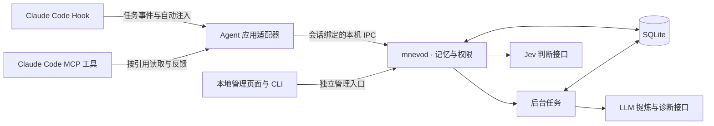

# Mnevo · 忆循 v0.1 技术设计

**早期技术设计评审稿。** 本文保留首个工程里程碑及其接口设想。当前行为见 [Mnevo 当前架构与流程](CURRENT_STATE.md) 和 [协议规范](PROTOCOL.md)。

产品范围及验收要求见 [v0.1 PRD](PRD.md)。

## 1. 首个工程里程碑

在 Claude Code 中开展研究报告任务的端到端验证。通过管理入口预置一条有出处的历史指标定义。新会话应自动收到记忆摘要和引用。Agent 使用引用读取历史定义，发现本期定义变更后提交工具执行结果。后台核验反馈后，后续同类任务的召回结果应反映此变化。另行启动一个会话，验证转发的引用无法用于读取记忆。

验证采用可控测试时钟及来源明确的资料。初期使用可复现的召回规则，随后将模型接入记忆形成、判断和策略改进。该里程碑验证 Claude Code 集成、权限校验和反馈处理。v0.1 还需通过自动形成记忆、衰减和策略治理验收。

## 2. 运行结构

服务、适配器和命令行界面（CLI）均用 Go 实现。首版由本机常驻服务 `mnevod` 管理 SQLite 数据库、业务规则和持久化后台任务。CLI 用于启动服务、启动 Agent 应用及执行管理操作。本地管理页面采用服务端 HTML 模板。

Agent 应用是用于运行和管理 Agent 会话的软件。适配器负责将 Agent 应用的事件转换为 Mnevo 的统一格式，并按应用要求返回结果。核心服务使用统一的任务上下文处理授权、记忆和反馈。工作范围可以是研究主题、个人任务、组织工作区或代码项目。代码目录可提供情境线索，会话身份和共享授权由服务核验。模型接口可以替换。模型输出供召回判断参考，权限检查和策略发布由服务执行。

## 3. Claude Code 适配与会话身份

- **自动注入。** 在目标 Claude Code 版本中，先验证任务提交事件 `UserPromptSubmit`，再验证工具批次结束事件 `PostToolBatch`。适配器使用事件支持的 `additionalContext` 字段提供记忆。预计无法在同步时限内返回内容时，适配器结束本次请求，Agent 应用继续执行。Mnevo 可在后台处理已接收的事件。 [Claude Code Hooks 文档](https://code.claude.com/docs/en/hooks)
- **Agent 工具。** 通过本机 MCP 标准输入输出进程提供按引用读取和显式反馈工具。两个工具均调用同一常驻服务。工具只接受业务参数，会话身份由适配器在与服务的连接中绑定。 [Claude Code MCP 文档](https://code.claude.com/docs/en/mcp)
- **会话启动。** 首选由 Mnevo CLI 启动 Claude Code 会话。启动器通过本机进程间通信（IPC）为本次启动注册短期且用途受限的会话凭据。Hook 与 MCP 适配进程从启动上下文获得绑定信息。Claude Code Hook 的 `session_id` 用于关联事件。公开的引用、会话 ID、当前目录和工具参数均不足以认证调用方。重新连接时须再次核验绑定。恢复会话后能否延续原授权，由集成验证确定。
- **隔离验证。** 在目标版本同时启动两个 Claude Code 会话，确认 Hook 和对应的 MCP 进程能够关联到同一会话，并验证跨会话使用引用时，读取和反馈请求均被拒绝。未完成绑定的会话仍可执行原有任务，Mnevo 不添加记忆或返回通用的不可用状态。

服务通过本机 IPC 接收请求，并按操作核验访问权限。Unix 平台可使用限制访问权限的 Unix 套接字。首版验证 Agent 应用中的会话隔离和引用转发。同一操作系统账户下的任意进程之间若需强隔离，须使用额外的操作系统控制。管理入口单独鉴权，浏览器端写操作须校验请求来源和会话。

## 4. 数据与接口

SQLite 保存记忆、反馈和生效策略，供服务读取和更新。拟通过 `database/sql` 接入无需 CGO 的 `modernc.org/sqlite`。驱动版本在目标平台完成 FTS5 功能和中文检索验证后确定。开发阶段使用随 Go 程序发布的单份 SQLite 建表脚本，新数据库在首次启动时初始化。 [SQLite Go 驱动文档](https://pkg.go.dev/modernc.org/sqlite) · [FTS5 文档](https://www.sqlite.org/fts5.html)

| 实体 | 关键数据与约束 |
| --- | --- |
| 记忆及版本 | 稳定 ID、主类型、归属、状态、当前版本。版本记录摘要、条件、线索、可交付细节与出处 |
| 证据 | 来源定位、版本或观测时间、允许的摘录及其可见范围。每条可交付主张关联可追溯的证据 |
| 共享规则 | 主体可以在哪些会话或工作范围执行哪些操作，以及来源侧的约束。只有授权管理操作能修改 |
| 交付记录与记忆引用 | 交付 ID、会话和任务标识、记忆版本、策略版本、交付内容层级及到期时间。模型接收的引用是由服务解析的标识 |
| 反馈及聚合 | 记录对应的交付、反馈来源和可选的证据。按记忆及有限的情境类别汇总。每次提交携带去重键 |
| 后台任务 | 持久化类型、去重键、执行状态、重试时间与租约。重启后可重新领取过期租约 |
| 策略版本与提案 | 参数快照、当前生效版本、证据、差异、审批记录及生效时间 |

下表定义三个逻辑操作的请求和响应。进程间通信的方法名在实现时确定。

| 操作 | 请求 | 响应 |
| --- | --- | --- |
| 接收 Agent 应用事件 | 统一格式的事件 ID、任务标识、类型、任务线索与截止时间 | 注入内容及引用，或无匹配、超时等状态 |
| `get_memory` | `reference` | 当前可交付的摘要、明细、适用边界及可读证据摘录。部分可用时标明哪些细节缺失 |
| `submit_memory_feedback` | `reference`、反馈分类、理由、可选证据引用、重试去重键 | 接收回执或失败状态。回执确认反馈已保存，可信度由后台证据核验确定 |

读取和反馈先核验连接所绑定的会话，再确认引用属于该会话当前获准访问的任务，并检查记忆版本、有效期与当前权限。任务标识由受信任的适配流程确定。任务结束时使其引用失效，具体由哪些 Claude Code 事件确认任务结束，须在集成验证中确定。未知、失效和越权的引用统一返回不可用。

撤销某条记忆的访问权限、停用或删除记忆后，引用读取和自动注入均停止交付该记忆。仅撤销原始证据的访问权限时，可继续交付独立获准共享且有证据支持的摘要。已替代的记忆版本同样停止向 Agent 交付，可由授权用户按审计规则查看。

证据回查可能涉及外部访问。服务在回查前校验来源权限，在输出前再次检查当前授权。回查无法完成时，仅返回仍可独立共享且有依据的内容。任何送往外部 Jev 或 LLM 的输入也应先按来源授权过滤和最小化。

## 5. 召回与反馈处理

1. **检索候选记忆。** 在获授权的范围内检索摘要和关键词，同时按主题、指标、资料标识或错误签名进行精确匹配。在规定数量内合并两路结果，再进行排序。命中精确线索的旧记忆可重新进入候选集。
2. **计算衰减。** 查询时按策略版本计算当前强度，初步采用半衰期模型。`当前强度 = 最近强化后的强度 × 2^(-经过时间 / 半衰期)`。按记忆类型配置参数，明确持续有效的约束按相应的适用性规则处理。衰减影响排序，版本、访问权限和有效期由各自规则控制。
3. **确定注入内容层级。** 结合适用范围、线索匹配、历史反馈和上下文长度限制，选择线索、摘要或细节。首个里程碑先注入摘要和引用。在规定时间内，可调用 Jev 评估候选记忆。模型超时时，若仍在总响应时限内，可仅提供规则和已有证据支持的内容。总时限到期时结束本次注入。每次决策使用固定的记忆和策略版本，并记录交付结果。
4. **接收并核验反馈。** 同一会话使用相同的去重键重试同一请求时，返回原接收结果。若去重键相同而请求内容不同，则返回冲突。重复提交检查、反馈保存及后台任务登记在同一事务内完成。可信证据可更新相应情境的反馈汇总和记忆强度。Agent 自报的结果先记为使用记录或修订线索。内容修订创建新版本。
5. **恢复和诊断。** 模型调用在数据库写事务外执行。后台任务完成核验后，在事务内确保业务结果只应用一次，并处理任务期间记忆或策略版本变化的情况。重要事件与定期整理使用同一持久任务队列，持续的系统性问题进入策略提案。

## 6. 策略发布

策略参数采用单层 `settings` 键，按项记录 `value`、`learn`、`apply` 和 `bounds`。配置文件用于初始化或由授权人导入导出，服务读写 SQLite 中的已发布配置快照。运行请求与后台学习开始时各自固定读取一个生效版本。

模型提案引用基准版本并提交带证据的值差异。服务校验学习许可、范围和生效方式，需审批的变更必须经管理入口批准。发布事务复核基准版本并原子更新生效指针，过期提案需重新核验。数据库保留前后值、依据、审批和生效时间。授权用户可以将恢复旧值作为新的变更提交。

## 7. 实施顺序与验收

| 阶段 | 完成条件 |
| --- | --- |
| A · 集成验证 | 同时运行两个真实会话，确认自动注入与 MCP 工具能够绑定到对应会话。验证跨会话引用及任务结束后的引用均不可用。服务断开或调用超时时，Claude Code 继续执行任务 |
| B · 端到端功能验证 | 使用预置研究记忆，依次验证自动注入、按引用读取、显式反馈及后续召回变化。验证重复提交处理，以及来源撤权和记忆停用后的引用行为 |
| C · 记忆演化 | 接入自动形成、衰减、精确线索、按内容层级读取及有界反馈聚合。用受控时钟测试淡出与重新唤起，验证后台任务重启恢复 |
| D · 策略治理与首版验收 | 验证后台生成提案、本地管理页面和命令行审查、授权发布及版本复核。按 PRD 验收研究、个人偏好与开发任务 |

工程验证需确定目标 Claude Code 版本、各平台服务启动方式、任务结束事件、Hook 等待上限、引用有效期和中文检索策略。端到端验收须保留 Claude Code 的注入记录、MCP 调用结果和使用相应策略版本的决策记录。
